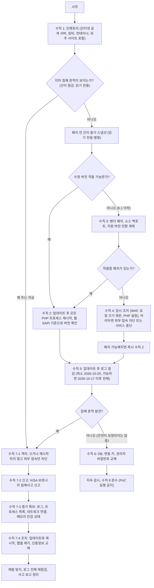

# PHP2Shell 사고 대응 런북 (KISA 대응 수칙 1~8 기준)

기준일: 2026-10-23. 대상: CVE-2026-109618, CVE-2026-109619. 방어용 문서이며 공격 코드·페이로드·재현 방법은 없습니다.
뼈대는 KISA 보호나라 [PHP 보안취약점(PHP2Shell) 관련 기업 보안 대응 수칙](https://www.boho.or.kr/kr/bbs/view.do?bbsId=B0000133&menuNo=205020&nttId=72230)(2026-10-22) 1~8번입니다. 보충 출처: [PHP 보안 공지](https://www.php.net/archive/2026.php#2026-10-21-5), [Sysdig](https://www.sysdig.com/blog/php2shell-cve-2026-109618-and-cve-2026-109619-detecting-unauthenticated-remote-code-execution-in-php-core), [Xint](https://xint.io/ko/blog/php2shell-vulnerability-emergency-response), [NCSC-NL](https://github.com/NCSC-NL/php2shell).

관련 문서: [`response-options.ko.md`](response-options.ko.md)(옵션 선택), [`offline-patching.ko.md`](offline-patching.ko.md)(폐쇄망), [`virtual-patching.ko.md`](virtual-patching.ko.md)(임시 완화), [`contacts.ko.md`](contacts.ko.md)(누구에게 연락하나).

## 0. 이 런북의 원칙

1. **"이상 징후가 없다"는 "안전하다"가 아닙니다.** 이 취약점은 애플리케이션 아래 단계(요청 파싱 단계)에서 동작해 애플리케이션 로그에 흔적이 거의 남지 않을 수 있고(Xint), 로그가 회전·삭제됐거나 공격자가 지웠을 수도 있습니다. KISA도 "기록상 이상이 없더라도 안전이 보장되지 않으므로, 업데이트와 인증정보 교체를 함께 진행"하라고 합니다(수칙 5). 아래의 모든 점검은 **발견되면 확정, 안 나오면 미확인**으로 읽으세요.
2. **패치가 유일한 근본 조치입니다.** PHP: "완전한 완화책은 없으며 업데이트만이 안전한 선택". 임시 설정과 WAF 규칙은 특정 경로만 줄이며 우회가 쉽습니다(Xint: 문자셋 변형, 대용량 데이터, RFC 2231/5987 인코딩 등).
3. **침해가 의심되면 재시작하지 않습니다.** 서버를 재시작하면 메모리에 남은 공격 흔적이 사라집니다(KISA 수칙 7). 업데이트·재시작 전에 증거를 먼저 확보합니다.
4. **출처가 불분명한 PoC를 실행하지 않습니다**(수칙 8). 취약 여부는 버전 확인과 기록 점검으로 판단합니다.
5. **로그·웹셸·서버를 지우거나 초기화하지 마세요.** 증거 은닉·폐기는 법적 문제가 될 수 있습니다([`contacts.ko.md`](contacts.ko.md)의 개인정보 포털 안내 참고).
6. 기록은 UTC와 KST를 함께 적습니다. 이 문서의 날짜는 별도 표기가 없으면 KST입니다.

## 1. 전체 순서 (플로차트)

KISA의 순서(수칙 1 -> 2 -> 3/4 -> 5 -> 6, 침해 시 7의 격리 -> 신고 -> 증거 -> 조치)를 따르되, 재시작이 증거를 지우는 문제 때문에 "패치 전 간이 스냅샷" 단계를 하나 둡니다(이 단계는 KISA 원문에 없는 이 문서의 권고입니다).



주의: 위 도표의 "Q1 아니오 -> 스냅샷"은 서버마다 수 분 걸리는 읽기 전용 작업입니다. 침해가 의심되는데 이미 패치와 재시작을 해버렸다면 그 사실(언제 무엇을 했는지)을 타임라인에 적고 8.4절의 증거 확보를 이어가세요.

> 플로차트는 Mermaid 문법으로 썼으며 렌더링해 보지 않았습니다(미검증). 렌더링이 안 되면 위 문장과 아래 수칙별 절을 순서대로 따르세요.

## 2. 수칙 1: 운영 중인 PHP 사용 현황 확인 (인벤토리)

KISA: 인터넷에 공개된 모든 홈페이지와 시스템의 PHP 사용 여부와 버전 확인. 외주 제작 사이트, 오래 관리하지 않는 사이트, 이벤트·테스트 서버, 관리자 페이지 포함. **자산 목록에만 의존하지 말고 실제 동작 중인 서버를 기준으로.** PHP가 내장된 장비·솔루션(네트워크 장비 관리 화면, PHP가 포함된 Windows용 설치 패키지 등)과 외부에서 받아 쓰는 컨테이너 이미지도 별도 확인.

### 2.1 확인 대상 체크리스트

- [ ] 인터넷에 공개된 모든 도메인·IP(웹 서버, 리버스 프록시 뒤의 백엔드 포함)
- [ ] 외주 제작 사이트, 방치된 사이트, 이벤트·테스트·스테이징 서버, 관리자 페이지
- [ ] 호스팅·클라우드 위탁 서비스(호스팅 업체에 적용 여부 확인·요청: KISA 개요 ※)
- [ ] PHP 내장 장비·솔루션(NCSC-NL의 [software 목록](https://github.com/NCSC-NL/php2shell)과 공급사 공지 확인), PHP가 포함된 Windows 설치 패키지
- [ ] 컨테이너·이미지(실행 중인 것, 레지스트리에 있는 것, 외부에서 받은 것), CI/CD 빌드 이미지
- [ ] 한 서버에 PHP가 여러 개 설치된 경우(각각)
- [ ] 사용 SAPI: mod_php, PHP-FPM, php-cgi, FrankenPHP, LiteSpeed (mod_php가 최우선: PHP가 위험이 가장 높다고 평가)

### 2.2 명령 (읽기 전용)

Linux 서버:
```bash
# 실제로 떠 있는 PHP 계열 프로세스
ps -eo pid,user,lstart,args | grep -E 'php-fpm|php-cgi|frankenphp|lsphp|litespeed|apache2|httpd' | grep -v grep

# Apache에 PHP 모듈이 적재됐는가 (mod_php)
apache2ctl -M 2>&1 | grep -i php     # RHEL 계열은 httpd -M

# 디스크에 있는 PHP 실행 파일·모듈 (여러 버전 후보)
find / -xdev \( -name 'php-fpm*' -o -name 'php-cgi*' -o -name 'libphp*.so' -o -name 'frankenphp' -o -name 'lsphp*' \) -type f 2>/dev/null

# 패키지 설치 현황
dpkg -l 'php*' | awk '/^ii/{print $2, $3}'      # Debian/Ubuntu
rpm -qa 'php*' | sort                            # RHEL/SUSE
apk info -v | grep '^php'                        # Alpine
```
- `find ... php-fpm*`은 설정 파일(`php-fpm.conf`), 맨 페이지까지 함께 나옵니다. 실행 파일만 보려면 결과에서 `/usr/sbin`, `/usr/bin`, `/opt`를 골라 보세요.
- [검증] debian:12에서 위 `find`, `apache2ctl -M | grep -i php`(`php_module (shared)` 출력), `ps ... | grep`, `dpkg -l 'php*' | awk ...`을, rockylinux:9에서 `rpm -qa 'php*' | sort`를, alpine:3.22에서 `apk info -v | grep '^php'`(출력 예 `php84-8.4.27-r0`)를 실행해 동작을 확인했습니다. 단, 이 서버들은 시험용 컨테이너이고 실제 서버의 인벤토리 결과는 아닙니다.

컨테이너:
```bash
docker ps --format '{{.ID}} {{.Image}} {{.Names}}'
for c in $(docker ps -q); do echo "== $c"; docker exec "$c" sh -c 'php -v 2>/dev/null | head -1; command -v php php-fpm apache2ctl httpd 2>/dev/null'; done
docker images --format '{{.Repository}}:{{.Tag}} {{.ID}}' | grep -i php
```
- [검증] php:8.4.27-cli-alpine 컨테이너에서 `docker exec ... php -v`가 `PHP 8.4.27 (cli) (built: Oct 21 2026 ...)`를 출력했고, `docker ps --format`, `docker images --format`이 동작했습니다.
- [검증] 쿠버네티스는 kind 클러스터(Kubernetes v1.37.0)에서 확인했습니다. 아래 명령이 모든 파드의 이미지를 나열했고, 취약 이미지(`php:8.4.26-fpm`)를 쓰는 파드가 목록에 보였습니다. 이미지 이름에 `php`가 없어도 PHP가 들어 있을 수 있으므로(WordPress, Drupal 이미지 등), 이미지 태그 이름만으로 판단하지 말고 파드 안에서 점검 스크립트를 실행하세요(재현: `tests/k8s_check.sh`).
```bash
kubectl get pods -A -o jsonpath='{range .items[*]}{.metadata.namespace}{"/"}{.metadata.name}{"\t"}{range .spec.containers[*]}{.image}{" "}{end}{"\n"}{end}'
kubectl cp php2shell-quickcheck.sh NAMESPACE/POD:/tmp/q.sh && kubectl -n NAMESPACE exec POD -- sh /tmp/q.sh --json   # 취약이면 종료 코드 1, 수정됨이면 0
```
- 컨테이너 안 `php -v`는 CLI입니다. 웹 SAPI(php-fpm, apache)의 바이너리 버전도 확인하세요(`response-options.ko.md` 6.4절).

Windows(미검증):
```powershell
Get-ChildItem -Path C:\ -Recurse -Include php.exe,php-cgi.exe,php-win.exe -ErrorAction SilentlyContinue |
  Select-Object FullName, @{n='Version';e={$_.VersionInfo.FileVersion}}
```
외부에서 본 단서(헤더 `X-Powered-By` 등)는 숨겨져 있을 수 있으므로 참고 정보로만 쓰세요: `curl -sI https://example.com | grep -i x-powered-by`(주소는 예시).

### 2.3 기록할 항목 (서버마다)

| 항목 | 값 |
|---|---|
| 호스트/서비스명, 소유 부서·외주 업체 | |
| 인터넷 공개 여부 (공개면 우선순위 높음) | |
| PHP 브랜치와 정확한 버전, 패키지 이름·버전 | |
| SAPI (mod_php / FPM / CGI / FrankenPHP / LiteSpeed) | |
| 업로드 필요 여부, 세션 사용 여부 | |
| 컨테이너인가, 이미지 태그·다이제스트 | |
| WAF/CDN 유무 | |
| 조치 계획(옵션 A~I) | |

옵션 선택은 [`response-options.ko.md`](response-options.ko.md) 3절의 결정표를 따르세요.

## 3. 수칙 2: 최신 버전 업데이트 및 재시작

KISA 요지(원문 기준):
- 해결 버전: PHP 8.5.12, 8.4.27, 8.3.36, 8.2.35 이상(리눅스 배포판·제조사 제공 업데이트 포함).
- **인터넷에 공개된 서버부터 우선 조치.**
- 업데이트 후 PHP를 실행하는 모든 웹 서비스(PHP-FPM, Apache mod_php, php-cgi, FrankenPHP, LiteSpeed 등)를 **반드시 재시작.** 재시작하지 않으면 메모리에 남은 이전 버전이 계속 동작합니다. 컨테이너는 신규 이미지 재배포.
- 업데이트 후 **웹 서비스가 실제로 쓰는 PHP의 버전이 바뀌었는지 확인.** `php -v`와 웹 서비스 버전이 다를 수 있어 한 서버에 PHP가 여러 개면 각각 확인.
- 배포판·제조사 패키지는 보안 패치를 적용해도 버전 번호가 안 바뀔 수 있으므로 **패키지 변경 이력에서 CVE 반영 여부 확인.**
- 패치 적용 시 호환성 문제로 장애가 날 수 있으므로 사전 영향도 검토와 테스트 후 적용.

실행 방법:
- 온라인: [`response-options.ko.md`](response-options.ko.md) 5절(OS별 명령)과 6절(증명).
- 폐쇄망: [`offline-patching.ko.md`](offline-patching.ko.md).
- 컨테이너: 옵션 C. 장비·호스팅: 옵션 E.

완료 기준(서버별):
- [ ] 설치된 패키지의 변경 이력에 CVE-2026-109618/109619가 있다(예: `rpm -q --changelog php-fpm | grep -E 'CVE-2026-10961[89]'`, `zcat /usr/share/doc/php8.2-cli/changelog.Debian.gz | grep -E 'CVE-2026-10961[89]'`)
- [ ] 모든 웹 SAPI 프로세스가 업데이트 이후에 시작됐다(`ps -eo pid,user,lstart,args`와 `ls -l /proc/[0-9]*/exe | grep deleted`)
- [ ] 웹 SAPI 바이너리가 의도한 버전이다(CLI의 `php -v`가 아님)
- [ ] 한 서버의 다른 PHP도 같은 방식으로 확인했다
- [ ] 기록(누가, 언제, 무엇을)을 남겼다

## 4. 수칙 3: 구버전(PHP 8.1 이하) 처리

KISA: 8.1 이하는 공식 업데이트가 없으므로 지원 버전으로 전환. 8.2도 2026-12-31에 보안 지원이 끝나므로 8.3 이상 권장. 전환에 시간이 걸리면 배포판·LTS 업체의 보안 패치 또는 PHP 보안팀이 공개한 7.4·8.0·8.1용 소스 패치를 임시로 적용하고 전환 계획 수립. 적용할 패치가 없다면 수칙 4의 임시 조치, 그것도 어려우면 외부 접속 차단 또는 서비스 일시 중단 검토.

| 브랜치 | 상태(출처: PHP 공지, Sysdig) | 선택 |
|---|---|---|
| 8.2~8.5 | 수정 버전 있음 | 수칙 2 |
| 7.4, 8.0, 8.1 | 공식 업데이트 없음. 일부 배포판·LTS 벤더 백포트, PHP 보안팀 최소 소스 백포트 브랜치 있음 | 벤더 패치 확인(옵션 A/B/E), 없으면 소스 빌드(옵션 D), 그 사이 F/G, 전환 계획(옵션 I) |
| 5.4~7.3 | EOL, 수정 없음, 소스 백포트 브랜치도 없음 | 지원 버전으로 이전(옵션 I)이 사실상 유일한 해결. 그 전까지 G/F |

소스 백포트 브랜치(PHP 공지): [7.4](https://github.com/php/php-src/tree/PHP-7.4-CVE-2026-109618-109619), [8.0](https://github.com/php/php-src/tree/PHP-8.0-CVE-2026-109618-109619), [8.1](https://github.com/php/php-src/tree/PHP-8.1-CVE-2026-109618-109619). 상세는 [`response-options.ko.md`](response-options.ko.md) 옵션 D·I.

## 5. 수칙 4: 즉시 업데이트가 어려울 때 임시 조치

KISA 요지:
- 웹 방화벽·웹 서버·프록시 등 PHP 앞단에서 **요청 크기를 제한**(요청 크기 정보가 없는 요청 포함). 파일 업로드가 필요 없으면 **multipart 요청을 차단**.
- 웹 방화벽을 쓰면 최신 차단 규칙이 적용됐는지 확인.
- PHP 공식 임시 설정을 `php.ini`, PHP-FPM pool 설정, 웹 서버 설정에 적용한 뒤 **모든 PHP 프로세스 재시작**:
  - `session.upload_progress.enabled = 0`
  - `memory_limit = -1` (애플리케이션이 바꿀 수 없도록 관리자 설정, 예: PHP-FPM pool의 `php_admin_value`)
  - `post_max_size` 낮게(업로드 불필요 8M, 필요 32M 수준), `upload_max_filesize`는 `post_max_size`보다 작게
  - PHP 8.5는 `fatal_error_backtraces = 0`
- 이것도 어려우면 **업데이트 전까지 외부 접속 차단 또는 서비스 일시 중단 검토**.

추가 주의(PHP 공지·Xint, [`data/advisory.json`](../data/advisory.json)):
- `memory_limit=-1`은 메모리 상한이 없어지므로 **컨테이너·cgroup·systemd `MemoryMax` 등 OS 수준 상한을 함께** 걸어야 합니다. `RLIMIT_AS`/`RLIMIT_DATA`를 대신 쓰면 취약한 할당 실패를 일으킬 수 있습니다.
- `session.auto_start=0`(Xint 추가 권고)은 `session_start()` 없이 `$_SESSION`을 쓰는 페이지의 세션 기능을 멈출 수 있습니다.
- `.user.ini`와 `ini_set()`에 의존하지 마세요(PHP 공지). `php_admin_value` 등 요청 파싱 이전에 적용되는 설정을 쓰세요.
- 설정 반영 후 **웹 요청으로** 값을 확인하세요(CLI가 아닌).

설정 파일 예시와 WAF·웹 서버 규칙은 [`virtual-patching.ko.md`](virtual-patching.ko.md)에 있습니다. **임시 조치는 공격을 완전히 막지 못합니다.**

## 6. 수칙 5: 업데이트 후 로그 점검

### 6.1 점검 범위

- KISA: **최소 10.20(취약점 정보 유출일) 이후의 기록 전체**를 점검하고, 가능하면 그 이전까지.
- Sysdig, `data/advisory.json`: 최초 악용 관측은 **2026-10-17**(Sysdig에 따르면 Amazon Threat Intelligence가 MadPot 허니팟에서 공개 4일 전에 PHP2Shell 시도를 관측). 기본 점검 시작일을 **2026-10-17**로 잡으세요.
- 아래 명령의 날짜(`2026-10-17`)는 기준 시작일입니다. 로그 보관 기간이 그보다 짧으면 가진 기록 전체와 그 한계를 사건 기록에 적으세요.

### 6.2 KISA 점검 항목과 명령

각 명령은 읽기 전용입니다. 경로는 환경에 맞게 바꾸세요(Debian 계열 `/var/log/apache2`, RHEL 계열 `/var/log/httpd`, nginx `/var/log/nginx`, PHP-FPM `/var/log/php*-fpm.log`).

**(1) 비정상 메모리 초과 오류 (Xint)**

정상적인 메모리 초과 오류에는 PHP 파일명과 줄 번호가 찍힙니다. `in Unknown on line 0`이면 요청 처리 전 단계에서 발생했다는 뜻이라 공격일 가능성이 높습니다(주로 mod_php 공격). PHP-FPM 공격은 애플리케이션 실행 도중에 발생해 실제 파일명이 찍히므로, 세션이나 `unserialize()` 관련 위치의 반복적 메모리 초과도 함께 의심하세요(Xint).
```bash
grep -E 'Allowed memory size of [0-9]+ bytes exhausted.*in Unknown on line 0' \
  /var/log/php_errors.log /var/log/apache2/error.log /var/log/httpd/error_log /var/log/php*-fpm.log 2>/dev/null

# 횟수만 보려면 -c (파일별 건수)
grep -cE 'Allowed memory size of [0-9]+ bytes exhausted.*in Unknown on line 0' \
  /var/log/php_errors.log /var/log/apache2/error.log /var/log/httpd/error_log /var/log/php*-fpm.log 2>/dev/null
```
- [검증] debian:12에서 가짜 로그 3줄로 시험: `in Unknown on line 0`인 줄만 매치되고 실제 파일명이 있는 줄은 매치되지 않음. 존재하지 않는 파일은 `2>/dev/null`로 조용히 건너뜁니다(이 때 grep 종료 코드는 2일 수 있음).
- 로그 회전된 파일(`error.log.1`, `*.gz`)도 점검합니다: `zgrep -E '...' /var/log/apache2/error.log*.gz`(미검증, `zgrep`은 표준 도구).

**(2) 크래시·워커 비정상 종료 (KISA: 원인을 알 수 없는 PHP 재시작, segfault, 메모리 부족 오류)**
```bash
grep -E "Segmentation fault|signal 11|SIGSEGV" \
  /var/log/apache2/error.log /var/log/httpd/error_log /var/log/php*-fpm.log 2>/dev/null
dmesg | grep -i segfault | grep -E "php|httpd|apache2"
```
- [검증] 가짜 Apache 로그(`exit signal Segmentation fault (11)`)에서 매치. `dmesg`는 컨테이너에서 권한 때문에 읽을 수 없어 호스트에서만 실제 동작합니다(문법 확인).
- 시스템 로그: `journalctl -k | grep -i segfault`, `journalctl -u php8.2-fpm --since 2026-10-17`, `coredumpctl list`는 널리 쓰이는 명령이지만 이 저장소에서 실행하지 않았습니다(미검증).
- Sysdig는 이 신호를 런타임 탐지에 씁니다: "PHP Web Worker Killed by Fatal Signal"(워커가 치명 신호로 종료), "PHP Web Worker Crash Followed by Shell Execution"(워커 충돌 뒤 셸 실행).

**(3) 비정상적으로 큰 요청과 반복된 HTTP 500**
```bash
# nginx/Apache combined 형식이면 9번째 필드가 상태 코드. 시간대별 500 횟수
awk '$9==500 {print substr($4,2,14)}' /var/log/nginx/access.log | sort | uniq -c

# POST 후 500
grep -E '"POST [^"]*" 500 ' /var/log/nginx/access.log
```
- [검증] 가짜 nginx 로그로 시험. 로그 형식이 `combined`가 아니거나 프록시 뒤라면 필드 번호가 다릅니다. 요청 크기는 기본 `combined`에 없으므로 `$request_length`(nginx) 또는 `%I`(Apache, `mod_logio`) 포함 형식을 쓰고 있다면 그 값이 큰 요청을 함께 보세요(형식 설정은 미검증).
- WAF·프록시·CDN 로그에서 **응답의 `PHPSESSID` 쿠키가 비정상적으로 길거나 깨진 값**인 경우는 메모리 노출 공격의 흔적일 수 있습니다(Xint). 이 서버의 로그에는 없고 WAF/프록시 로그에서 확인합니다.

**(4) 비정상적으로 큰 세션 파일 (Xint)**
```bash
# 세션 저장 경로는 php.ini의 session.save_path (Debian 계열 기본값은 보통 /var/lib/php/sessions)
find /var/lib/php/sessions -name 'sess_*' -size +1M -exec ls -lh {} \;
```
- [검증] `/tmp/sess`에 만든 2 MB 파일이 나옴. 경로는 환경에 맞게 바꾸세요.
- 세션 파일은 기본 설정에서 24분(`session.gc_maxlifetime = 1440`초)이 지나면 정리 대상이므로 시간이 지나면 이 방법으로 확인하기 어렵습니다(Xint). 가능한 빨리 확인하고 **지우기 전에 복사**하세요.

**(5) 웹 폴더, 업로드 폴더, 임시 폴더에 새로 생기거나 바뀐 PHP 파일(웹셸)**
```bash
# 2026-10-17 이후 수정된 PHP 계열 파일 (문서 루트는 환경에 맞게)
find /var/www -type f \( -name '*.php' -o -name '*.phtml' -o -name '*.phar' -o -name '*.php[0-9]' \) -newermt 2026-10-17 -ls

# 상태 변경 시각(ctime) 기준: touch 등으로 수정 시각을 위조해도 ctime은 남음
find /var/www -type f -name '*.php' -newerct 2026-10-17 -ls

# 임시 폴더
find /tmp /var/tmp /dev/shm -type f -newermt 2026-10-17 -ls 2>/dev/null
```
- [검증] debian:12에서 가짜 파일(2026-10-20 수정 `a.php`, 2026-10-01 수정 `old.php`)로 시험: 10-17 이후 파일만 나옴. `-newerct`는 `touch`로 mtime을 바꿔도 ctime은 지금으로 갱신되므로(변경 사실 자체를 보여줌) **mtime 위조 탐지용이지만 정상 배포·백업 복원도 ctime을 바꿉니다**(해석 주의).
- 최근 3일 안에 바뀐 파일을 보는 방식(`find /var/www -name '*.php' -mtime -3 -ls`, Xint)도 같은 목적입니다. 날짜 기준 `-newermt`가 점검 시작일과 맞추기 쉽습니다.
- 파일 무결성 대조: 패키지에서 설치된 PHP 자체 파일이 바뀌었는지 `dpkg --verify php8.2-cli`(Debian 계열), `rpm -V php-cli`(RHEL 계열)로 볼 수 있습니다. [검증] 두 명령 모두 변경이 없을 때 출력 없이 종료 코드 0. 애플리케이션 파일은 버전 관리 저장소나 배포 산출물과 대조하세요.
- 발견한 의심 파일은 **지우지 말고** 격리 복사 후 해시(`sha256sum`)를 기록하세요(8.4절).

**(6) 웹 서버가 명령 실행 프로그램(sh, bash)이나 다운로드 도구를 실행한 흔적 / 웹 서버의 외부 연결**
```bash
# 웹 서버 계정이 실행 중인 프로세스 (계정명은 환경에 맞게: www-data, apache, nginx)
ps -u www-data -o pid,ppid,lstart,cmd

# 모든 프로세스 트리에서 웹 서버 아래에 셸이나 다운로드 도구가 있는지
ps -eo pid,ppid,user,lstart,args --forest

# 웹 서버·PHP 프로세스의 네트워크 연결 (외부 주소로의 새 연결)
ss -tnp | grep -E "php|httpd|apache2|nginx"
ss -tnpH state established
```
- [검증] debian:12에서 문법 시험(대상 프로세스가 없으면 헤더만 출력/종료 코드 1, 정상). 서버가 이미 재시작되었다면 과거 흔적은 프로세스 목록에 남지 않습니다.
- KISA 항목 "알 수 없는 외부 주소로 새로 연결한 흔적"은 방화벽·프록시·NetFlow 로그에서 웹 서버의 아웃바운드 연결을 보는 것이 가장 신뢰할 만합니다. 서버 자체의 로그는 공격자가 건드릴 수 있습니다.
- Sysdig가 점검하라고 한 추가 항목: **웹셸, 새 cron 작업, 새 계정, 웹 서버 프로세스가 띄운 셸.**
```bash
# 새 cron 작업, 새 계정, 최근 변경된 SSH 공개 키
find /etc/cron* /var/spool/cron -newermt 2026-10-17 -ls 2>/dev/null
crontab -l -u www-data
getent passwd | awk -F: '$3==0 || $3>=1000 {print $1":"$3}'
find / -xdev -name authorized_keys -newermt 2026-10-17 -ls 2>/dev/null
last -n 50
```
- [검증] debian:12에서 문법 시험(출력 형식 확인). `last`는 wtmp가 없으면 비어 있을 수 있습니다.

**(7) 홈페이지·결제 페이지에 몰래 추가된 외부 스크립트 (KISA)**
```bash
grep -rIlE --include='*.php' --include='*.js' --include='*.html' '<script[^>]+src=["'"'"']?https?://' /var/www
```
- [검증] 가짜 HTML 1건에서 매치. 정상 외부 스크립트(CDN, 분석 도구)도 모두 나오므로 **허용 목록·배포 산출물과 대조**해야 의미가 있습니다. 빌드된 결과물에서는 차이만 보는 것이 효율적입니다.

Windows(미검증):
```powershell
Get-ChildItem -Path C:\inetpub\wwwroot -Recurse -Include *.php,*.phtml,*.phar -ErrorAction SilentlyContinue |
  Where-Object { $_.LastWriteTime -gt [datetime]'2026-10-17' } | Select-Object FullName, LastWriteTime
```

### 6.3 결과 해석

| 결과 | 의미 | 다음 |
|---|---|---|
| (1)(2)에서 `in Unknown on line 0`이나 segfault가 2026-10-17 이후 반복 | 공격 시도 또는 성공 가능성 높음 | 8절(격리 -> 신고 -> 증거 -> 조치) |
| (5)에서 설명할 수 없는 새 PHP 파일 | 웹셸 의심 | 8절 |
| (6)에서 웹 계정의 셸·다운로드 도구 실행, 알 수 없는 외부 연결 | 코드 실행 성공 가능성 높음 | 8절 |
| 아무것도 안 나옴 | **안전이 보장되지 않음**(로그 부재·삭제·회전 가능성, 메모리 노출은 흔적이 안 남을 수 있음) | 수칙 6 인증정보 교체까지 진행 |

PHP와 웹 서버 로그를 봐야 하며, 이 취약점은 공격이 실패해도 해당 로그에 흔적이 남을 수 있습니다(Xint). 애플리케이션 로그만으로는 부족합니다.

## 7. 수칙 6: 중요 인증정보 교체

KISA 근거: 이 취약점은 서버 메모리에 담긴 비밀번호, 접속 인증값(토큰), 외부 서비스 연동 키(API 키) 등을 유출시킬 수 있습니다(CVE-2026-109619 권고 참조). 업데이트 전까지 인터넷에 노출됐던 서버는 DB 비밀번호, 외부 서비스 연동 키, 관리자 계정 비밀번호 교체를 권장하며, **침해 흔적이 발견된 서버는 반드시 교체.** Sysdig: 메모리 노출은 RCE와 별개로 동작하며 다른 요청의 자격 증명, 세션 토큰, API 키, TLS 개인 키까지 담길 수 있어, **코드 실행 흔적이 없어도** 노출된 서버의 비밀은 교체해야 합니다.

### 7.1 교체 대상

| 대상 | 비고 |
|---|---|
| DB 계정 비밀번호 | 읽기 전용·애플리케이션 계정 모두. 교체 후 애플리케이션 설정과 연결 풀 갱신 |
| 외부 서비스 연동 키(API 키, 결제·메일·SMS·스토리지) | 공급사 콘솔에서 재발급하고 옛 키 폐기 |
| 관리자 계정 비밀번호(CMS, 관리 화면, 호스팅 콘솔) | 다요소 인증 활성화 권장 |
| 세션 토큰 | 사용자 세션 무효화(서버 측 세션 저장소 비우기. **지우기 전에 증거로 복사**). 사용자에게 재로그인이 필요함을 알림 |
| 애플리케이션 암호화·서명 키 | 예: 프레임워크의 앱 키, CMS의 인증 키·솔트. 교체 시 기존 서명 값·암호화 데이터가 무효화될 수 있어 영향 검토 |
| TLS 개인 키·인증서 | 같은 프로세스 메모리에 있었다면 노출 가정(Sysdig 언급). 인증서 재발급과 옛 인증서 폐지 |
| SSH·배포 키, CI/CD 토큰 | 서버에 있던 것 |
| 클라우드 자격 증명, 컨테이너의 서비스 계정·마운트된 비밀 | 컨테이너 침해 시 서비스 계정과 마운트된 비밀, 네트워크 위치를 가진다고 Sysdig가 설명 |

### 7.2 순서와 주의 (이 표의 순서는 이 문서의 권고)

1. **패치와 재시작(또는 격리)이 끝난 서버의 비밀부터 교체하세요.** 취약한 서버에 새 비밀을 넣으면 같은 방식으로 다시 노출될 수 있습니다.
2. **침해 서버는 증거 확보 후** 교체합니다. 교체 전에 증거(파일, 메모리 민감 상태, 설정)를 복사해 두세요.
3. 권한이 큰 비밀(DB 관리자, 클라우드 키, 관리자 계정)부터, 영향 범위를 고려해 교체합니다.
4. 교체 시각을 타임라인에 기록하고, 옛 비밀이 **교체 후에도 사용되는 흔적**(로그인 시도, API 호출)을 감시합니다.
5. 침해 흔적이 없어도 노출 서버는 교체를 권장합니다(KISA: "업데이트와 인증정보 교체를 함께 진행").

## 8. 수칙 7: 침해사고 발생 시 (순서 엄수)

KISA 원문 순서: ① 격리 -> ② 신고 -> ③ 증거 확보 -> ④ 조치. 법정 신고 기한은 증거 수집을 기다려 주지 않으므로 ②와 ③은 실제로 격리 직후 **병행**하는 것이 안전합니다([`contacts.ko.md`](contacts.ko.md)의 설명). 신고서에는 확인된 내용부터 쓰고 나중에 보완합니다.

### 8.1 ① 격리: 서버를 끄거나 재시작하지 말고, 외부 접속만 차단

- 하지 말 것: 전원 끄기, 재시작, 서비스 재기동, `php-fpm`/`apache2` 중지, 컨테이너 삭제·재생성, 로그 삭제, 웹셸 즉시 삭제, 재설치.
- 할 것: 네트워크 계층에서 외부(인터넷) 접속만 차단. 방화벽, 로드밸런서, 클라우드 보안 그룹, 스위치/VLAN에서 차단하거나 트래픽을 다른 노드로 돌립니다. 증거 확보와 분석을 위한 내부 관리 접속은 유지합니다.
- 가상 서버·클라우드: 가능하면 이 시점에 스냅샷(디스크와 메모리 포함 가능 여부는 플랫폼에 따라 다름)을 만듭니다. 가상 서버는 스냅샷과 가상 디스크 파일, 일반 서버는 디스크 백업, 악성코드는 격리 보존이 안내돼 있습니다([`contacts.ko.md`](contacts.ko.md)).
- 호스트 방화벽 명령은 환경 의존적이므로 이 문서에 적지 않았습니다. 조직의 네트워크 팀 절차를 따르세요.

### 8.2 ② 신고

[KISA 보호나라](https://boho.or.kr) -> 침해사고 신고 -> 신고하기. 신고 방법, 전화, 필요한 준비물, 기한(정보통신망법 24시간, 개인정보 유출 72시간 등), 금융·공공기관·경찰은 [`contacts.ko.md`](contacts.ko.md)를 보세요(이 문서는 법률 자문이 아닙니다).

### 8.3 ③ 증거 확보 체크리스트

휘발성이 큰 것부터. **수집한 모든 파일은 별도 매체나 원격 증거 저장소에 쓰고(침해 서버의 로컬 디스크에 쓰지 마세요), 수집 직후 해시를 기록합니다.**

- [ ] 수집자, 시작·종료 시각(UTC와 KST), 서버 호스트명, 서버 시계의 편차(`date -u`와 신뢰 가능한 시각 비교)
- [ ] 메모리 민감 상태: 서버를 재시작하면 사라집니다(KISA). 조직이 승인·검증한 메모리 수집 도구가 있다면 이 시점에 사용합니다. 가상화 환경은 메모리 포함 스냅샷이 가능한지 확인하세요. 도구는 사전에 검증된 것만 쓰고 **출처 불명 도구를 설치하지 마세요**(수칙 8 취지). 이 저장소는 특정 도구를 검증하지 않았습니다.
- [ ] 실행 중인 프로그램 목록(프로세스 트리, 시작 시각, 명령줄)
- [ ] 네트워크 연결 정보(연결, 수신 대기 포트, 라우팅)
- [ ] 웹 서버 계정이 실행 중인 프로세스의 실행 파일·작업 디렉터리
- [ ] 로그 전체 복사: 웹 서버 access/error, PHP-FPM, PHP error log, 시스템 로그(auth, syslog, journal), WAF/프록시/CDN, 방화벽 로그. 보관 기간이 짧은 로그부터
- [ ] 세션 파일(`sess_*`)과 임시 디렉터리의 의심 파일 복사(지우기 전에)
- [ ] 의심 PHP 파일(웹셸 후보): 경로, 소유자, 권한, mtime/ctime/atime, 해시. 격리 보관본을 만들고 원본은 증거 확보 전에 삭제하지 않음. 열어 실행하지 말 것
- [ ] 새 cron, 새 계정, SSH 키 변경(6.2절 (6))
- [ ] 설치된 PHP·웹 서버 패키지와 버전, 설정 파일(`php.ini`, `conf.d`, FPM pool, 웹 서버 설정)
- [ ] 컨테이너면: 이미지 ID, 컨테이너 ID, 실행 중 컨테이너의 파일시스템 변경 내용, 컨테이너 로그
- [ ] 수집물 목록과 SHA-256 해시(`sha256sum`), 보관 위치, 접근자(증거 관리 기록)
- [ ] 사진·화면 캡처보다 원본 데이터를 우선하고, 모든 작업을 타임라인에 기록

**읽기 전용 수집 스크립트 예시**: 침해 서버에서 메모리·디스크를 건드리는 변경은 하지 않고, 증거 경로에만 씁니다. `EVID`는 마운트한 외부 증거 저장소로 지정하세요(예: `/mnt/evidence`). 웹 서버 계정명, 문서 루트, 점검 시작일은 환경에 맞게 바꾸세요.
```sh
#!/bin/bash
# 목적: 침해 의심 서버의 휘발성 정보와 핵심 로그를 증거 경로에 수집한다.
# 보호하지 못하는 것: 메모리 덤프(포함하지 않음), 공격 차단. 수집 자체가 서버 상태를 일부 바꿀 수 있음(읽기 위주 명령만 사용).
# 적용 전: EVID가 침해 서버의 로컬 디스크가 아닌 별도 매체인지 확인. root로 실행해야 /proc 항목을 읽을 수 있음.
# 되돌리기: 해당 없음(수집물은 삭제하지 말고 보관).
EVID=${EVID:-/mnt/evidence/$(hostname)-$(date -u +%Y%m%dT%H%M%SZ)}
DOCROOT=${DOCROOT:-/var/www}
WEBUSER=${WEBUSER:-www-data}
SINCE=${SINCE:-2026-10-17}
mkdir -p "$EVID" || exit 1
{ date -u; hostname; uname -a; id; } > "$EVID/00-meta.txt" 2>&1
ps -eo pid,ppid,user,lstart,etime,args --forest > "$EVID/10-ps-forest.txt" 2>&1
ps auxww > "$EVID/11-ps-aux.txt" 2>&1
for p in $(pgrep -u "$WEBUSER"); do
  echo "== $p"; ls -l /proc/$p/exe /proc/$p/cwd 2>&1; tr '\0' ' ' < /proc/$p/cmdline; echo
done > "$EVID/12-webuser-proc.txt" 2>&1
ss -tanp > "$EVID/20-ss-tcp.txt" 2>&1
ss -uanp > "$EVID/21-ss-udp.txt" 2>&1
ss -lntup > "$EVID/22-ss-listen.txt" 2>&1
ip addr > "$EVID/23-ip-addr.txt" 2>&1
ip route > "$EVID/24-ip-route.txt" 2>&1
lsof -nP -i > "$EVID/25-lsof-net.txt" 2>&1
who -a > "$EVID/30-who.txt" 2>&1
last -n 100 > "$EVID/31-last.txt" 2>&1
tar -czf "$EVID/40-logs.tgz" /var/log/apache2 /var/log/httpd /var/log/nginx /var/log/php* /var/log/auth.log /var/log/secure 2>/dev/null
find "$DOCROOT" -type f -newermt "$SINCE" -ls > "$EVID/50-docroot-newer.txt" 2>&1
getent passwd > "$EVID/60-passwd.txt"
ls -la /etc/cron* > "$EVID/61-cron.txt" 2>&1
crontab -l -u "$WEBUSER" > "$EVID/62-cron-$WEBUSER.txt" 2>&1
(cd "$EVID" && sha256sum * > SHA256SUMS)
echo "증거 경로: $EVID"
```
- [검증] debian:12 컨테이너(procps, iproute2, lsof, apache2 설치)에서 실행해 17개 파일과 `SHA256SUMS`가 생성되고 `sha256sum -c`가 모두 통과함을 확인했습니다. 컨테이너에서는 권한 제한 때문에 `/proc/PID/exe` 읽기가 거부되었는데, 실제 서버에서는 root로 읽을 수 있어야 합니다(미검증). `tar` 대상 중 없는 경로는 오류를 숨겼습니다. 이 스크립트는 메모리를 수집하지 않습니다.
- `last`, `lsof`, `ss`, `ip`는 배포판에 기본 설치되지 않았을 수 있습니다(procps, iproute2, lsof 패키지).

### 8.4 ④ 조치 (증거 확보 후)

- [ ] 서비스 정상화 전에 침해 범위 판단: 웹셸, 새 계정, cron, SSH 키, 변조 파일, 외부 연결
- [ ] **업데이트 및 재시작**(수칙 2). 컨테이너는 새 이미지 재배포
- [ ] 웹셸 제거(격리 보관본을 이미 확보한 뒤), 변조된 파일 복원(신뢰할 수 있는 배포 산출물에서). 침해 정도가 크면 재설치하고 신뢰 가능한 소스에서 복원
- [ ] 인증정보 교체(7절): DB, 연동 키, 관리자, 세션, 키·인증서
- [ ] 같은 인프라의 다른 서버로 확산됐는지 점검(내부망 침투 가능성: KISA 개요)
- [ ] 외부 연결 차단 해제는 패치 확인과 로그 점검 후 단계적으로
- [ ] 재발 방지: F/G/H 적용 상태 점검, 아웃바운드 제한, 권한 축소([`response-options.ko.md`](response-options.ko.md) 옵션 H)
- [ ] 피해 확인: 개인정보 유출 여부, 이용자 통지 필요 여부는 [`contacts.ko.md`](contacts.ko.md)의 기한·기관 안내를 확인

### 8.5 타임라인 표

사고 대응 중 모든 행위를 시간순으로 기록합니다. 서식은 [`templates/`](../templates/) 디렉터리의 타임라인 양식을 사용하세요(이 문서는 서식 파일을 만들지 않았습니다). 양식을 쓸 수 없으면 아래 열을 그대로 표로 쓰세요.

| 시각(UTC) | 시각(KST) | 분류 | 사건/조치 | 출처(로그 파일, 장비, 사람) | 증거 파일과 SHA-256 | 사실 / 추정 | 담당자 |
|---|---|---|---|---|---|---|---|
| | | 탐지 / 격리 / 신고 / 증거 / 조치 / 통지 | | | | | |

기록할 필수 시점: 최초 이상 징후 시각(최소 2026-10-17 이후 기록 점검), 인지 시각(신고 기한의 기산점이 될 수 있으므로 정확히), 격리 시각, 신고 시각과 접수 번호, 증거 수집 시작·종료, 패치·재시작 시각, 인증정보 교체 시각, 서비스 복구 시각.

## 9. 수칙 8: 출처가 불분명한 PoC 실행 지양

- 인터넷에 유포되는 PoC에는 악성코드가 숨겨진 가짜가 많습니다(KISA).
- 취약 여부는 **PoC 실행이 아니라** 버전 확인(웹 SAPI 기준)과 패키지 변경 이력, 기록 점검으로 판단합니다.
- 분석이 꼭 필요하면 업무망과 분리된 환경에서만 수행합니다.
- Xint의 점검 스크립트는 PoC가 아니라 설정 점검 도구라고 소개되지만, 이 저장소는 그 스크립트를 검증하지 않았습니다. 사용한다면 코드를 직접 읽고 공개된 SHA-256과 대조한 뒤, 운영 서버에는 추측하기 어려운 이름으로 잠시만 올리고 확인 직후 삭제하세요([`response-options.ko.md`](response-options.ko.md) 2.1절).
- 이 저장소의 어떤 문서도 공격을 재현하는 방법을 담지 않으며, WAF·점검 규칙은 공개된 징후(`PHP_SESSION_UPLOAD_PROGRESS` 필드 이름, 깊게 중첩된 대괄호 필드 이름, 빈 `filename=""` 파트 다수, 길이 정보 없는 chunked multipart)만 다룹니다.

## 10. 연락처

누구에게 어떻게 연락하는지(KISA 보호나라·118, 개인정보 유출 신고, 금융·공공, 경찰청 사이버범죄 신고 등)는 [`contacts.ko.md`](contacts.ko.md)에 있습니다. 연락처·법령 조문은 바뀔 수 있으므로 신고 전에 원문을 다시 확인하세요.

## 11. 한 장 요약

1. 인벤토리를 실제 동작 기준으로 만든다. 인터넷 공개 서버, mod_php 서버부터.
2. 침해가 의심되면: 끄지 말고 재시작하지 말고 외부 접속만 차단 -> 신고 -> 증거 -> 조치.
3. 의심이 없으면: 간이 스냅샷 -> 수정 버전으로 업데이트 -> **모든 PHP 프로세스 재시작** -> 웹 SAPI 기준 버전과 변경 이력 확인.
4. 패치가 안 되면: WAF·웹 서버 요청 크기 제한, PHP 임시 설정(`session.upload_progress.enabled=0` 등), 그것도 안 되면 외부 차단. 이는 우회가 쉬운 임시 조치.
5. 2026-10-17 이후 로그를 점검한다. 아무것도 안 나와도 안전하지 않다.
6. DB·연동 키·관리자 비밀번호를 교체한다.
7. 출처 불명 PoC를 실행하지 않는다.

## 12. 검증 기록

환경: aarch64 호스트의 Docker. Docker Hub 익명 pull이 제한(429)되어 이미지는 `mirror.gcr.io/library/<이미지>`에서 받은 것과 기존 이미지를 사용했습니다.

| 항목 | 이미지 | 결과 |
|---|---|---|
| `grep` 메모리 초과·segfault, `awk` 500 집계, `find -newermt/-newerct/-size`, `ps`/`ss` 문법, 외부 스크립트 `grep -rIlE`, `getent`/`find` cron | debian:12 (가짜 로그·파일로 시험) | 동작 |
| `dmesg \| grep -i segfault` | debian:12 | 문법만. 컨테이너에서는 `dmesg` 접근이 거부됨 |
| `dpkg --verify php8.2-cli`, `rpm -V php-cli` | debian:12, rockylinux:9 | 변경 없을 때 출력 없이 종료 코드 0 |
| 증거 수집 스크립트 | debian:12 (apache2 포함) | 17개 파일과 `SHA256SUMS` 생성, 해시 검증 통과 |
| `docker ps/images --format`, `docker exec ... php -v` | php:8.4.27-cli-alpine | 동작 |
| Mermaid 플로차트 | - | 렌더링하지 않음(미검증) |
| Windows PowerShell 명령, `kubectl`, `journalctl`, `coredumpctl`, `zgrep`, 메모리 수집, 호스트 방화벽 격리 | - | 미검증 |
